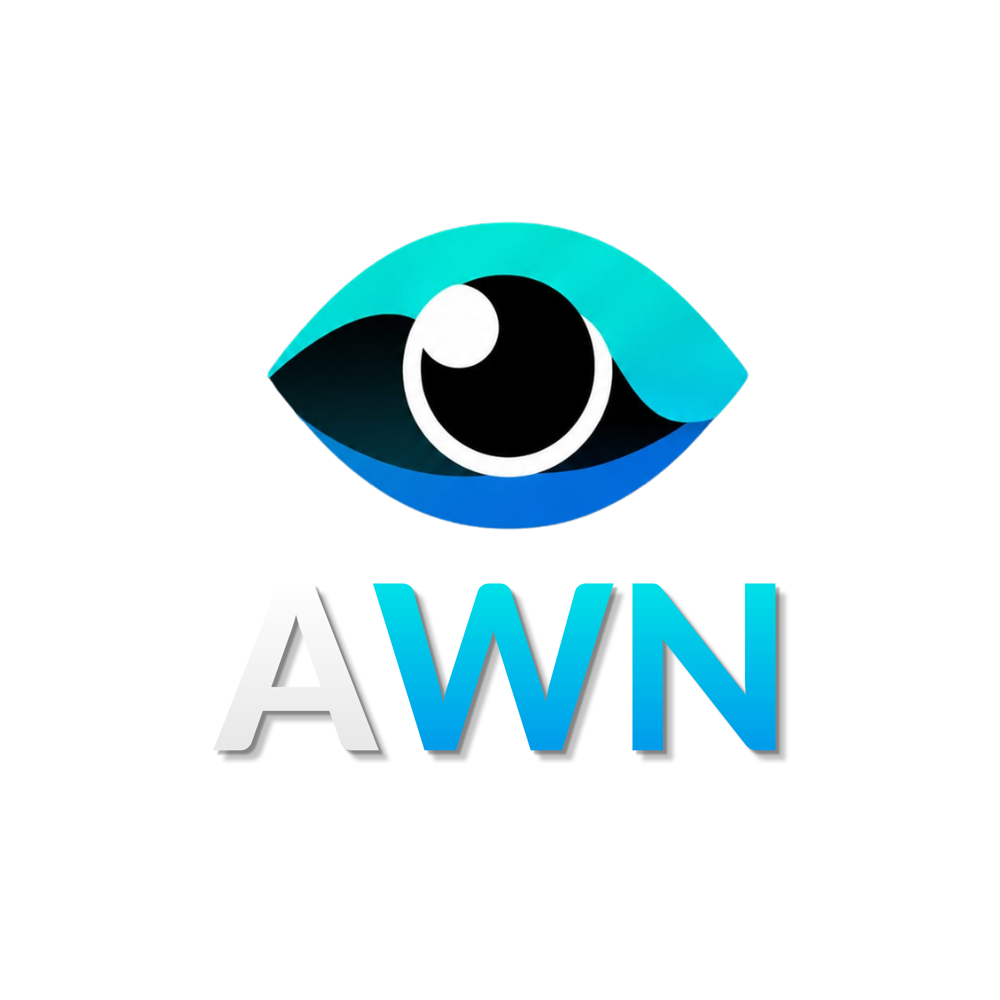
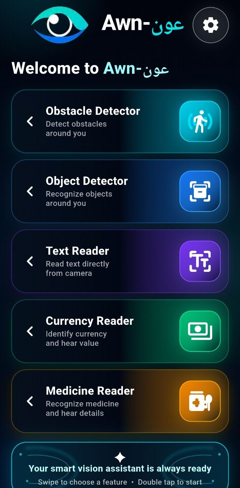
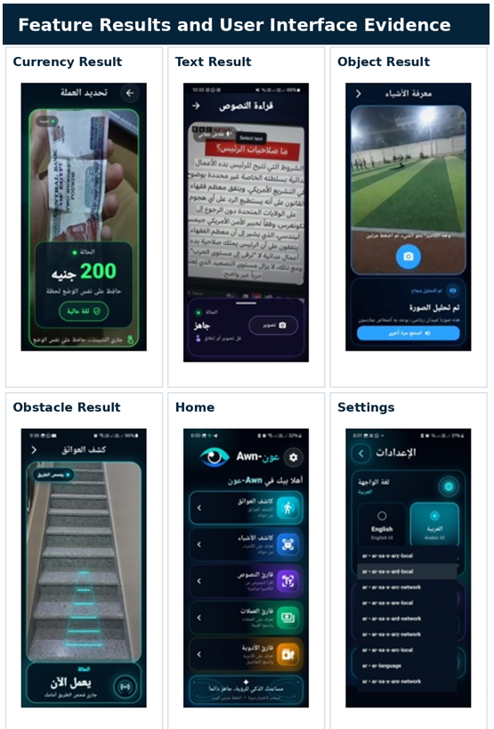
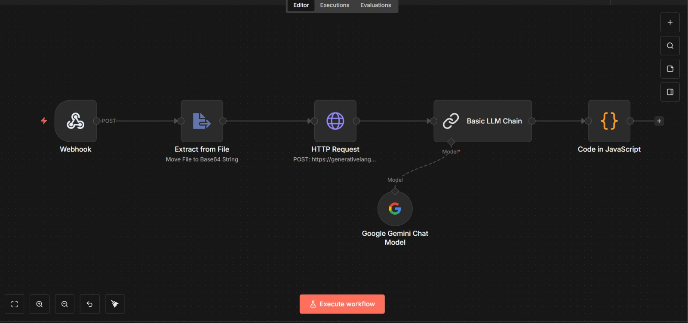

<p align="center">
  
</p>

<h1 align="center">AWN (عَوْن) — AI-Powered Spatial Awareness Ecosystem</h1>

<p align="center">
  <em>A holistic object detection and spatial awareness system engineered to empower visually impaired individuals through real-time AI inference, cross-platform accessibility, and cloud-native intelligence.</em>
</p>

<p align="center">
  
  
  
  
  
  
  
  
</p>

<p align="center">
  <strong>Graduation Project — B.Sc. Artificial Intelligence</strong><br/>
  Faculty of Computers and Artificial Intelligence · Menoufia University · 2026
</p>

---

## 📋 Abstract

**AWN** (Arabic: عَوْن, meaning *"Help"*) is a comprehensive AI-powered ecosystem designed from the ground up to serve as a digital spatial awareness companion for blind and visually impaired individuals. Rather than being a single application, AWN is architected as a **tightly coupled, three-pillar system** where each layer — the cross-platform mobile client, the high-performance cloud backend, and the deep learning model pipeline — is a first-class citizen that contributes equally to the system's overall intelligence.

The ecosystem fuses **on-device edge inference** (TensorFlow Lite) for instantaneous obstacle and currency detection with **cloud-based large language model reasoning** (Google Gemini 2.5 Flash, Meta Llama 4 Scout via Groq) for rich scene understanding, medication identification, and Arabic/English OCR post-processing. Every interaction is delivered through an accessible, bilingual (Arabic/English) mobile interface with full Text-to-Speech narration and haptic feedback, ensuring zero visual dependency.

---

## 🏗️ System Architecture — The Three Core Pillars

AWN is built on three interdependent architectural pillars. None of them is a secondary layer; together they form a cohesive, production-grade ecosystem.

```
┌──────────────────────────────────────────────────────────────────┐
│                       AWN ECOSYSTEM                              │
│                                                                  │
│   ┌──────────────┐   ┌──────────────┐   ┌──────────────────┐    │
│   │   📱 PILLAR 1 │   │   ⚡ PILLAR 2 │   │   🧠 PILLAR 3    │    │
│   │   Mobile App  │◄─►│  Backend API │◄─►│  Deep Learning   │    │
│   │   (Flutter)   │   │  (FastAPI)   │   │  (YOLO/TFLite)   │    │
│   └──────────────┘   └──────────────┘   └──────────────────┘    │
│        │                    │                     │               │
│   Edge Inference      LLM Orchestration     Model Training       │
│   TTS / Haptics       Gemini · Groq         YOLOv11 Pipeline     │
│   Bilingual UI        Azure OCR · n8n       PyTorch · Roboflow   │
└──────────────────────────────────────────────────────────────────┘
```

---

### 📱 Pillar 1 — Cross-Platform Mobile Application (Flutter / Dart)

The AWN mobile client is not merely a "front-end wrapper" — it is a **fully capable edge-inference device** that runs deep learning models directly on the user's hardware, eliminating network latency for critical safety features like obstacle detection.

<p align="center">
  
</p>

| Capability | Implementation |
|---|---|
| **Framework** | Flutter 3.x with Dart SDK ^3.10 — single codebase for Android & iOS |
| **Edge ML Inference** | TensorFlow Lite runtime (`tflite_flutter`) executes YOLOv11 and EfficientDet models on-device at 15–30 FPS |
| **Camera Pipeline** | Real-time camera stream processing (`camera` package) with frame-by-frame analysis |
| **OCR (On-Device)** | Google ML Kit Text Recognition for instant English text detection; Tesseract OCR for Arabic script |
| **Text-to-Speech** | Full bilingual TTS engine (`flutter_tts`) with automatic Arabic ↔ English switching based on detected script |
| **Haptic Feedback** | Context-aware vibration patterns: heavy impact for Arabic text alerts, light impact for English readings |
| **Accessibility** | Fully voiced UI with zero visual dependency — every screen, button, and result is narrated |
| **State Management** | Feature-based architecture with Controllers, Services, and Screens per module |
| **Bilingual UI** | Native Arabic (ar-EG) and English (en-US) interface with `SharedPreferences` persistence |

**Feature Modules** (inside `flutter/lib/features/`):
- `obstacle/` — Real-time obstacle detection with spatial distance estimation
- `currency/` — Egyptian banknote recognition via on-device TFLite inference
- `object_identifier/` — General object identification with cloud LLM scene description
- `text_reader/` — Hybrid OCR pipeline (Google ML Kit + Tesseract) with smart language switching
- `medicine/` — Medication reader powered by cloud n8n workflow + Gemini

---

### ⚡ Pillar 2 — High-Performance Backend API (FastAPI / Python)

The AWN backend is a **scalable, asynchronous microservices API** that orchestrates multiple AI providers and serves as the intelligence hub for features that require cloud-grade computation or large language model reasoning.

| Capability | Implementation |
|---|---|
| **Framework** | FastAPI with async/await throughout — high-throughput, low-latency REST API |
| **LLM Integration: Scene Description** | Google Gemini 2.5 Flash via `google-genai` SDK — real-time image-to-text spatial analysis in Arabic |
| **LLM Integration: Object Analysis** | Meta Llama 4 Scout 17B via Groq API — vision-language understanding with sub-second inference |
| **OCR: Azure Computer Vision** | Azure Cognitive Services for production-grade Arabic + English text extraction with polling-based result retrieval |
| **OCR: Post-Processing** | LLM-powered OCR cleanup — Gemini reformats raw OCR noise into natural, TTS-ready sentences |
| **Medication Feature** | External n8n workflow integration via webhook-driven HTTP forwarding |
| **Containerization** | Production Docker image (`python:3.11-slim`) with health checks, deployed on Hugging Face Spaces / Koyeb |
| **Configuration** | Centralized `Settings` class with environment variable resolution and safe `YOUR_API_KEY_HERE` fallback defaults |
| **CORS** | Fully open CORS middleware for cross-origin Flutter HTTP client access |

**API Endpoints:**

| Method | Endpoint | Description |
|---|---|---|
| `GET` | `/` | Service status and endpoint directory |
| `GET` | `/health` | Health check for container orchestration |
| `POST` | `/api/v1/describe-scene` | 🧠 Gemini-powered scene description (real AI) |
| `POST` | `/api/v1/detect-objects` | Object detection with spatial metadata |
| `POST` | `/api/v1/read-text` | Text extraction and narration |
| `POST` | `/api/v1/estimate-distance` | Distance estimation for closest obstacle |
| `POST` | `/api/v1/extract-text` | Azure OCR advanced text extraction |
| `POST` | `/api/v1/detect-drug` | Medication identification via external n8n workflow |

---

### 🧠 Pillar 3 — Machine Learning & Deep Learning Pipeline (PyTorch / YOLO / TFLite)

The AWN model pipeline spans the full ML lifecycle: dataset curation (Roboflow), model training (PyTorch + Ultralytics), quantization (TensorFlow Lite), and deployment (on-device & cloud).

#### Training Infrastructure

| Component | Detail |
|---|---|
| **Base Architecture** | YOLOv11 (Ultralytics) — `yolo11n.pt` (nano) and `yolo11s.pt` (small) variants |
| **Training Framework** | PyTorch 2.x with CUDA acceleration (NVIDIA RTX 3060) |
| **Dataset Management** | Roboflow for annotation, augmentation, and version control |
| **Obstacle Dataset** | 51,320 training images + 14,231 validation images — custom Blind Navigation Dataset |
| **Currency Dataset** | Egyptian banknote images across all denominations with YOLO-format annotations |
| **Training Strategy** | AdamW optimizer, cosine LR schedule, mosaic augmentation, mixed-precision (AMP), early stopping (patience=15) |
| **Model Checkpointing** | Best + Last weights saved per run, optimizer stripped for production deployment |

#### Inference Strategy: Cloud vs. Edge

AWN employs a **dual-inference architecture** — choosing the optimal execution environment based on the feature's latency requirements and accuracy demands:

| Dimension | ☁️ Cloud Inference (YOLOv11 / LLMs) | 📱 Edge Inference (TFLite / EfficientDet) |
|---|---|---|
| **Execution** | Backend FastAPI server or Groq/Gemini cloud | On-device via TensorFlow Lite runtime |
| **Latency** | 200–800ms (network round-trip) | 30–80ms (hardware-accelerated) |
| **Accuracy** | Higher — full FP32 model weights, LLM reasoning | Optimized — INT8/FP16 quantized models |
| **Use Case** | Scene description, medication ID, OCR cleanup | Obstacle detection, currency recognition |
| **Model Size** | 19–38 MB (full `.pt` weights) | 5–10 MB (quantized `.tflite`) |
| **Network** | Required | Not required (fully offline) |

**Quantization Pipeline:** Full-precision PyTorch checkpoints (`.pt`) → TensorFlow Lite conversion → Float16 / Int8 quantization → Bundled as mobile assets

#### Model Registry (`models/`)

| Directory | Contents | Count |
|---|---|---|
| `models/pretrained/` | Base YOLO weights (`yolo11n.pt`, `yolo11s.pt`) | 2 |
| `models/obstacle/` | Fine-tuned YOLOv11 blind navigation models (`.pt` + `.tflite`) | 11 |
| `models/currency/` | Egyptian currency detection model (`.tflite`) | 1 |
| `models/mobile/` | Mobile-optimized TFLite models (FP16, INT8, EfficientDet) | 3 |

---

## ✨ Key Features & Visual Results

AWN delivers five primary accessibility features, each combining edge and cloud intelligence:

- **🚧 Obstacle Detection & Spatial Mapping** — Real-time YOLOv11 object detection with bounding-box spatial positioning and distance estimation. Alerts the user via TTS narration and haptic vibration patterns when obstacles are detected ahead.

- **💵 Egyptian Currency Recognition** — On-device TFLite inference identifies Egyptian banknotes in real-time through the camera viewfinder. No internet connection required — operates fully offline at 15+ FPS.

- **🔍 General Object Detection & Scene Description** — Captures a photo, sends it to the Gemini 2.5 Flash or Llama 4 Scout LLM, and returns a concise Arabic spatial description (e.g., *"أمامك باب مفتوح وعلى يمينك كرسي"*).

- **📖 Bilingual Text Reader (Arabic + English OCR)** — Hybrid pipeline: Google ML Kit for real-time English text streaming, Tesseract OCR for Arabic capture-and-read. Smart language detection auto-switches TTS voice between Arabic and English.

- **💊 Medication Reader** — Photograph a medication box → the image is forwarded to an automated n8n workflow → Gemini extracts the drug name → a second LLM chain returns Arabic drug information (benefits, side effects, warnings).

<p align="center">
  
</p>

---

## 💊 Advanced Medication Workflow (n8n & LLM Pipeline)

The Medication Reader feature implements a **fully automated, webhook-driven AI pipeline** using [n8n](https://n8n.io/) — an open-source workflow automation platform. This decoupled architecture allows the medication intelligence to be updated, scaled, or swapped independently of the mobile app and backend.

**Pipeline Flow:**

```
📱 Flutter App                    ⚡ FastAPI Backend                 🔄 n8n Workflow (Railway)
      │                                  │                                  │
      │  POST /api/v1/detect-drug        │                                  │
      │ ─────────────────────────────►    │                                  │
      │                                  │  Forward image via webhook        │
      │                                  │ ────────────────────────────────► │
      │                                  │                                  │
      │                                  │                          ┌───────┴───────┐
      │                                  │                          │ Extract File  │
      │                                  │                          │ (Binary→B64)  │
      │                                  │                          └───────┬───────┘
      │                                  │                                  │
      │                                  │                          ┌───────┴───────┐
      │                                  │                          │ HTTP Request  │
      │                                  │                          │ Gemini Flash  │
      │                                  │                          │ → Drug Name   │
      │                                  │                          └───────┬───────┘
      │                                  │                                  │
      │                                  │                          ┌───────┴───────┐
      │                                  │                          │ LLM Chain     │
      │                                  │                          │ Gemini Chat   │
      │                                  │                          │ → Arabic Info │
      │                                  │                          └───────┬───────┘
      │                                  │                                  │
      │                                  │                          ┌───────┴───────┐
      │                                  │                          │ Code (JS)     │
      │                                  │                          │ → Structured  │
      │                                  │                          │   JSON Output │
      │                                  │                          └───────┬───────┘
      │                                  │                                  │
      │                                  │  ◄──── JSON Response ────────────│
      │  ◄──── TTS Narration ────────────│                                  │
```

**n8n Nodes:**
1. **Webhook** — Receives the medication image as a POST multipart upload
2. **Extract from File** — Converts binary image data to Base64 encoding
3. **HTTP Request → Gemini 2.5 Flash** — Sends the image to the Generative Language API with the prompt: *"Extract ONLY the exact medication name from the image"*
4. **Basic LLM Chain → Gemini Chat** — Takes the extracted drug name and generates structured Arabic medication information (name, benefits, side effects, warnings)
5. **Code (JavaScript)** — Parses the LLM output into a clean JSON response: `{ drug_name_ar, pros, side_effects, cons }`

The workflow file is version-controlled at `workflows/medication_feature_n8n.json`.

<p align="center">
  
</p>

---

## 📁 Directory Structure

```text
AWN/
├── README.md                              # This documentation
├── requirements.txt                       # Root Python dependencies (all modules)
│
├── models/                                # ✅ Preserved Model Weights
│   ├── pretrained/                        # Base YOLO weights (yolo11n.pt, yolo11s.pt)
│   ├── currency/                          # Egyptian currency TFLite model
│   ├── obstacle/                          # Fine-tuned YOLOv11 blind navigation (.pt & .tflite)
│   └── mobile/                            # Mobile-optimized TFLite (FP16, INT8, EfficientDet)
│
├── src/                                   # Backend Source Code
│   ├── awn_api/                           # FastAPI Backend Server
│   │   ├── app/
│   │   │   ├── api/routes/                # REST endpoint handlers (OCR, etc.)
│   │   │   ├── services/                  # Gemini, Azure OCR service integrations
│   │   │   ├── models/                    # Pydantic request/response schemas
│   │   │   ├── utils/                     # Shared utility functions
│   │   │   ├── config.py                  # Centralized settings & env resolution
│   │   │   └── main.py                    # FastAPI application entrypoint
│   │   ├── Dockerfile                     # Container deployment configuration
│   │   ├── .env.example                   # Environment variable template
│   │   └── requirements.txt               # Backend-specific dependencies
│   ├── training/                          # Model Training & Evaluation
│   │   ├── train_currency_model.py        # YOLOv11 currency training script
│   │   ├── evaluate_currency_model.py     # Validation & visual prediction export
│   │   └── test_obstacle_models.py        # Obstacle detection benchmark suite
│   └── inference/                         # Standalone Inference Services
│       └── object_detection_service.py    # Groq / Llama 4 image analysis microservice
│
├── data/                                  # Datasets, Labels & Benchmarks
│   ├── currency_dataset/                  # Training/testing currency images
│   ├── labels/                            # Class label definitions
│   └── benchmarks/                        # Performance evaluation outputs & CSVs
│
├── notebooks/                             # Jupyter Research Notebooks
│   ├── obstacle_detection_experiments.ipynb
│   └── obstacle_detection_training.ipynb
│
├── workflows/                             # Automation Workflows
│   └── medication_feature_n8n.json        # n8n medication identification pipeline
│
└── flutter/                               # Flutter Cross-Platform Mobile App
    ├── lib/
    │   ├── main.dart                      # Application entrypoint
    │   ├── core/                          # Shared app-wide utilities & themes
    │   ├── screens/                       # Top-level screen widgets
    │   └── features/                      # Feature modules
    │       ├── obstacle/                  # Real-time obstacle detection
    │       ├── currency/                  # Egyptian currency recognition
    │       ├── object_identifier/         # General object ID + LLM scene description
    │       ├── text_reader/               # Bilingual OCR (ML Kit + Tesseract)
    │       └── medicine/                  # Medication reader (n8n integration)
    ├── assets/
    │   ├── models/                        # On-device TFLite model assets
    │   ├── labels/                        # Label map files for inference
    │   └── images/                        # App icons and UI assets
    ├── android/                           # Android platform configuration
    └── pubspec.yaml                       # Flutter dependencies & asset declarations
```

---

## 🚀 Installation & Setup

### Prerequisites

- **Python** 3.11+
- **Flutter** 3.x with Dart SDK ^3.10
- **CUDA** 11.8+ (for GPU-accelerated model training — optional for inference)
- **Docker** (optional, for containerized backend deployment)

### 1. Clone the Repository

```bash
git clone https://github.com/Mohamed-Sameh-Mansour/AWN.git
cd AWN
```

### 2. Backend Setup (FastAPI)

```bash
# Create and activate a virtual environment
python -m venv venv
source venv/bin/activate        # Linux/macOS
venv\Scripts\activate           # Windows

# Install all Python dependencies
pip install -r requirements.txt

# Configure environment variables
cp src/awn_api/.env.example src/awn_api/.env
```

Edit `src/awn_api/.env` and insert your actual API keys:

```env
GEMINI_API_KEY=YOUR_GEMINI_API_KEY_HERE
AZURE_OCR_KEY=your_azure_ocr_key_here
AZURE_OCR_ENDPOINT=https://your-region.api.cognitive.microsoft.com
GROQ_API_KEY=your_groq_api_key_here
EXTERNAL_ML_SERVER_URL=https://your-n8n-server.up.railway.app/webhook/Image-grapper
```

Start the development server:

```bash
cd src/awn_api
uvicorn app.main:app --host 0.0.0.0 --port 8000 --reload
```

The API documentation will be available at `http://localhost:8000/docs`.

### 3. Docker Deployment (Alternative)

```bash
cd src/awn_api
docker build -t awn-api .
docker run -p 7860:7860 --env-file .env awn-api
```

### 4. Mobile App Setup (Flutter)

```bash
cd flutter

# Install Flutter dependencies
flutter pub get

# Run on a connected device or emulator
flutter run
```

> **Note:** Ensure that the backend API URL inside the Flutter app's service configuration points to your running FastAPI server (local or deployed).

### 5. Model Training (Optional)

```bash
# Train the currency detection model
python src/training/train_currency_model.py

# Evaluate model performance
python src/training/evaluate_currency_model.py

# Run obstacle detection benchmarks
python src/training/test_obstacle_models.py
```

---

## 👥 Team Members

| # | Name | Role |
|---|---|---|
| 1 | [Mohamed Sameh Farag Mansour] | [Model training and evaluation] |
| 2 | [Yahia Zakaria Mezied] | [Model training and evaluation] |
| 3 | [Sherif Mohamed Zakaria] | [Model training and evaluation] |
| 4 | [Mahmoud Abdelrazek Soliman Anbr] | [flutter mobile app dev] |
| 5 | [Seif Hossam Youssef] | [flutter mobile app dev] |
| 6 | [Mohamed Ahmed Abdelazim] | [API development] |
| 7 | [Abdelrahman Mohamed Tawfik] | [API development] |

---

## 📄 License

This project was developed as a graduation requirement for the **Bachelor of Science in Artificial Intelligence** program at the **Faculty of Computers and Artificial Intelligence, Menoufia University, 2026**.

---

<p align="center">
  <strong>AWN (عَوْن)</strong> — <em>Because independence is a right, not a privilege.</em>
</p>
